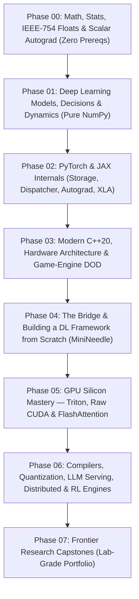

# 🧠 From Zero to Silicon: The Complete Deep Learning & ML Systems Curriculum


> **Mission Statement:** *"Python is just the steering wheel. I am learning how to build the engine."*  
> Modern AI is bottlenecked as much by physical hardware and memory movement as by mathematical imagination. This repository is my self-contained, multi-year curriculum, laboratory, and research portfolio taking me from **first-principles mathematics and computer arithmetic (zero assumed prerequisites)** all the way to **unmatched mastery of Deep Learning architectures, C++20 data-oriented engines, custom frameworks, GPU CUDA/Triton kernels, distributed training, and high-throughput RL physics systems.**

---

## 🧭 Start Here: Core Documents

| Document | Purpose |
| :--- | :--- |
| 📜 **[MANIFESTO_AND_PROTOCOL.md](./MANIFESTO_AND_PROTOCOL.md)** | Who I am training to become (*The Unicorn Bridge*), the **Old-School Mastery Protocol** (learning deeply without AI crutches), and the **Game Engine $\leftrightarrow$ ML Systems Rosetta Stone**. |
| 📚 **[READING_LIST_AND_PAPERS.md](./READING_LIST_AND_PAPERS.md)** | The complete, chronological syllabus of primary textbooks, university courses, hardware manuals, and 30 seminal papers mapped phase-by-phase. |
| 📔 **[JOURNAL.md](./JOURNAL.md)** | Daily engineering log documenting every struggle, bug, benchmark, and mathematical *"Aha!"* moment. |
| 🔬 **[99_Verification_and_Papers/](./99_Verification_and_Papers/)** | Three-pass paper dissection notes and symbolic/statistical ground-truth verification scripts (MATLAB / SymPy / `mpmath`). |

---

## 🏗️ The Chronological Architecture (8 Mastery Phases)

Every phase is **strictly chronological**: no forward-reference magic, no black boxes. Every mathematical idea is built from geometric and statistical intuition first, then immediately implemented from scratch so you **watch theory perform practical magic** on real data, visual simulations, and hardware profilers.



| Phase | Directory & Self-Contained Guide | Core Layer | Key Question Answered | Boss Fight (Gatekeeper Exam) |
| :---: | :--- | :--- | :--- | :--- |
| **00** | **[00_Math_and_Numeric_Foundations](./00_Math_and_Numeric_Foundations/README.md)** | **First-Principles Math & Bits** | *How do bits represent real numbers, and how do linear algebra, calculus, probability, and information theory create learning?* | Build `MicroEngine` (scalar/vector autograd + 2D spiral classifier + live decision-boundary animation) in pure Python. |
| **01** | **[01_Deep_Learning_From_Scratch](./01_Deep_Learning_From_Scratch/README.md)** | **Model Decisions & Dynamics** | *Why do ResNets, LayerNorm/RMSNorm, Kaiming Init, AdamW, RoPE, GQA, Transformers, VAEs, Diffusion, and PPO look the exact way they do?* | Build a pure-NumPy modular DL library + character-level Transformer & Gridworld RL agent (zero PyTorch/JAX). |
| **02** | **[02_PyTorch_and_JAX_Internals](./02_PyTorch_and_JAX_Internals/README.md)** | **Framework Front-Ends** | *How do PyTorch (dynamic DAG, strided views) and JAX (pure functions, `vmap`/`grad`/`jit`, XLA HLO) actually execute under the hood?* | Raw-tensor `nanoGPT` + Hamiltonian Monte Carlo (HMC) sampler benchmarked in Eager PyTorch vs `torch.compile` vs JAX XLA. |
| **03** | **[03_Cpp_and_Hardware_Architecture](./03_Cpp_and_Hardware_Architecture/README.md)** | **CPU Silicon & Game-Engine DOD** | *Where do numbers physically live in virtual memory, L1/L2/L3 caches, Arena allocators, and AVX2 SIMD registers?* | **Part A:** 100k-body C++20 SoA + SIMD 2D physics sim (>1,000 FPS). **Part B:** Cache-tiled AVX2 + OpenMP GEMM plotted on a CPU Roofline chart. |
| **04** | **[04_DL_Systems_and_Custom_Engine](./04_DL_Systems_and_Custom_Engine/README.md)** | **The Bridge & Custom Framework** | *How does Python talk zero-copy to C++ (`Pybind11` / `ATen`), and how do you build your own PyTorch from scratch?* | Build **`MiniNeedle`** (custom strided C++ `NDArray` + Python autograd + NN library) & ship a custom fused PyTorch C++ extension. |
| **05** | **[05_GPU_Architecture_Triton_CUDA](./05_GPU_Architecture_Triton_CUDA/README.md)** | **GPU Silicon & Kernel Engineering** | *How do 10,000+ GPU threads, warps, SRAM banks, and Tensor Cores execute tiled GEMM and online-softmax FlashAttention?* | Climb the CUDA SGEMM ladder toward `cuBLAS` + implement tiled **FlashAttention** from scratch in Triton & raw CUDA. |
| **06** | **[06_Compilers_Inference_Scale_RL](./06_Compilers_Inference_Scale_RL/README.md)** | **Compilers, Scale & RL Engines** | *How do `torch.compile`, INT4 quantization, `vLLM` PagedAttention, `FSDP`/`Megatron`, and 1M-FPS C++/CUDA RL engines work?* | Build **`TinyInfer`** (zero-Python C++/CUDA quantized LLM engine) **or** **`HyperEnv`** (10,000-world batched C++/CUDA RL physics engine). |
| **07** | **[07_Frontier_Research_Capstones](./07_Frontier_Research_Capstones/README.md)** | **Research & Synthesis** | *Can I invent or co-design a hardware-aware statistical/ML algorithm and prove a 10x–50x speedup at lab publication standards?* | Flagship open-source research repository written and benchmarked like a DeepMind / Meta FAIR / Mila systems paper. |

---

## ⏳ Suggested Multi-Year Pacing (Mastery Over Speed)

This curriculum is designed for **deep, unhurried, multi-year mastery** (~2 to 3 years alongside work/research, governed by passing Boss Fights rather than racing a calendar):

- **Year 1 — Mathematical Intuition, Model Decisions & Framework Internals (`Phases 00 – 02`)**: Never guess *why* an equation, initializer, normalization layer, or tensor stride exists again.
- **Year 2 — Silicon Mechanics, Game-Engine C++ Systems, Custom Frameworks & GPU Kernels (`Phases 03 – 05`)**: Escape the Python sandbox completely; command CPU caches, SIMD, C++ extensions, Triton, raw CUDA, and FlashAttention.
- **Year 3 — Compilers, Distributed Scale, RL Simulation Engines & Frontier Research (`Phases 06 – 07`)**: Operate at the exact intersection of theoretical statistics, systems compilers, multi-GPU clusters, and publication-grade research.

---

## 🚀 Live Progress Tracker

> *Note on migration:* Previously completed modules from the initial Phase 1 (`Tensor Memory Layout`, `Math Operations & Measurement Culture`, and early `Autograd`) now live in **[02_PyTorch_and_JAX_Internals/](./02_PyTorch_and_JAX_Internals/)**. Before finishing Phase 02, complete Phases 00 and 01 so every mathematical and architectural decision underneath PyTorch/JAX is rock solid from scratch.

### Phase 00: Math, Statistics, Floats & Scalar Autograd
- [ ] Module 0.1: Binary, IEEE-754 (`FP32`/`FP16`/`BF16`), Underflow/Overflow & Log-Sum-Exp
- [ ] Module 0.2: Geometric Linear Algebra, Change of Basis, Eigendecomposition & SVD
- [ ] Module 0.3: Multivariable & Matrix Calculus, Jacobians, Hessians & Forward vs Reverse AD
- [ ] Module 0.4: Probability, MLE/MAP, Entropy, Cross-Entropy & KL Divergence
- [ ] Module 0.5: Conditioning, Ravines & Optimization Foundations
- [ ] 🏆 **Boss Fight 00:** `MicroEngine` Scalar/Vector Autograd & Live 2D Classifier

### Phase 01: Deep Learning Architectures & Decisions (Pure NumPy)
- [ ] Module 1.1: Matrix Backpropagation & `einsum` Mastery
- [ ] Module 1.2: Signal Propagation, Xavier/Kaiming Proofs & Activation Evolution (`ReLU` $\to$ `SwiGLU`)
- [ ] Module 1.3: Normalization (`BatchNorm` $\to$ `LayerNorm` $\to$ `RMSNorm`) & Residual Highways
- [ ] Module 1.4: Optimization Dynamics (`SGD` $\to$ `Momentum` $\to$ `AdamW`, Schedules & Curvature)
- [ ] Module 1.5: Spatial & State-Space Biases (`Conv2d`/`im2col`, RNNs & SSMs)
- [ ] Module 1.6: Tokenization (BPE), Attention Variance Math, `RoPE`, `GQA` & Transformers from Scratch
- [ ] Module 1.7: Generative Models (`VAE`, Diffusion/Flow) & Deep RL (`MDPs`, Policy Gradients, `PPO`)
- [ ] 🏆 **Boss Fight 01:** Pure-NumPy DL Library + Character Transformer / RL Agent

### Phase 02: PyTorch & JAX Internals
- [x] Module 2.1: Tensor Storage, Offsets, Strides & Contiguity *([Notebook](./02_PyTorch_and_JAX_Internals/Module%201%20%28Tensor%20Memory%20Layout%29.ipynb))*
- [x] Module 2.2: In-Place vs Out-of-Place, Broadcasting & Measurement Culture *([Notebook](./02_PyTorch_and_JAX_Internals/Module%202%20%28Math%20Operations%20%26%20Early%20Measurement%20Culture%29.ipynb))*
- [ ] Module 2.3: PyTorch Autograd Engine, Saved Tensors, Custom `Function` & Dispatcher *([In Progress](./02_PyTorch_and_JAX_Internals/Module%203%20%28Autograd%20%26%20Calculus%20Engines%29.ipynb))*
- [ ] Module 2.4: Raw-Tensor `nanoGPT` & KV-Cache Mechanics
- [ ] Module 2.5: JAX Functional Paradigm, PyTrees & Splittable PRNGs
- [ ] Module 2.6: JAX Transformations (`grad`, `jvp`/`vjp`, `vmap`, `lax.scan`, `jit`) & Reading XLA HLO
- [ ] 🏆 **Boss Fight 02:** Raw-Tensor Transformer + HMC Sampler (PyTorch vs JAX XLA Showdown)

### Phase 03: Modern C++20, Hardware Architecture & Game-Engine DOD
- [ ] Module 3.1: CMake, Compilation Pipeline (`godbolt`), Visual Studio Debugger/Disassembly & `ASan`
- [ ] Module 3.2: Virtual Memory, Stack vs Heap & Zero-Copy `mmap` Weight Loading
- [ ] Module 3.3: Pointers, `std::span`, RAII Smart Pointers & Move Semantics
- [ ] Module 3.4: CPU Caches, Data-Oriented Design (`AoS` vs `SoA`) & Custom Arena Allocators
- [ ] Module 3.5: The Roofline Model, Arithmetic Intensity & C++ `<chrono>` Microbenchmarking
- [ ] Module 3.6: Instruction Pipelining, AVX2/FMA SIMD Intrinsics & Multithreading
- [ ] 🏆 **Boss Fight 03:** 100k-Particle DOD Physics Sim (>1,000 FPS) + Cache-Tiled AVX2 CPU GEMM

### Phase 04: The Bridge & Custom DL Framework (`MiniNeedle`)
- [ ] Module 4.1: `torch.profiler`, Perfetto Flame Graphs & Amdahl's Law
- [ ] Module 4.2: CPython C-API Mental Model, Buffer Protocol, `Pybind11` & GIL Management
- [ ] Module 4.3: LibTorch / `ATen` C++ Tensors & Custom Autograd Extensions (JIT & AOT)
- [ ] Module 4.4: `MiniNeedle` Part 1 — Python Automatic Differentiation & Higher-Order Graphs
- [ ] Module 4.5: `MiniNeedle` Part 2 — Strided C++ `NDArray` Backend
- [ ] Module 4.6: `MiniNeedle` Part 3 — `nn`, `optim`, `DataLoader` & End-to-End Training
- [ ] 🏆 **Boss Fight 04:** Train a Mini-Transformer on `MiniNeedle` + Ship Fused PyTorch C++ Package

### Phase 05: GPU Architecture, OpenAI Triton & Raw CUDA
- [ ] Module 5.1: GPU SMs, Warps (SIMT), Divergence & Memory Hierarchy (Registers/SRAM/L2/HBM)
- [ ] Module 5.2: OpenAI Triton Block Programming & Fused Softmax / RMSNorm / Cross-Entropy
- [ ] Module 5.3: Raw CUDA C++ Execution Hierarchy, Streams & Global Memory Coalescing
- [ ] Module 5.4: Shared Memory Tiling, Bank Conflicts, Warp Shuffles (`__shfl_sync`) & Prefix Scan
- [ ] Module 5.5: The CUDA GEMM Optimization Ladder (Global $\to$ Shared $\to$ Register Tiling $\to$ Tensor Cores)
- [ ] Module 5.6: Online Softmax Derivation & Implementing **FlashAttention** from Scratch
- [ ] Module 5.7: Nsight Systems (`nsys`), Nsight Compute (`ncu`) & CUDA Graphs
- [ ] 🏆 **Boss Fight 05:** 85%+ `cuBLAS` SGEMM Worklog + Tiled FlashAttention Kernel

### Phase 06: Compilers, Quantization, Inference, Distributed Scale & RL Engines
- [ ] Module 6.1: ML Compilers (`TorchDynamo`, `AOTAutograd`, `TorchInductor`, TVM/MLIR)
- [ ] Module 6.2: Low-Precision & Quantization (`BF16`, `FP8`, `INT8`, `INT4` Fused Dequant-GEMV)
- [ ] Module 6.3: LLM Serving (`Prefill` vs `Decode`, KV-Cache, `PagedAttention`, Speculative Decoding, `llama.cpp`)
- [ ] Module 6.4: Distributed Training (`Ring-AllReduce`, `ZeRO`/`FSDP`, Tensor, Pipeline & Ring Parallelism)
- [ ] Module 6.5: High-Throughput Batched C++/CUDA RL Simulation Environments (>1M Steps/Sec)
- [ ] 🏆 **Boss Fight 06:** `TinyInfer` C++/CUDA LLM Engine **or** `HyperEnv` Batched GPU RL Physics Engine

### Phase 07: Frontier Research Capstones
- [ ] 🏆 **Boss Fight 07:** Complete & Publish Flagship Hardware-Accelerated Research Repository

---

## 🛠️ Unified Workstation & High-Performance Tooling Stack

Your workflow is split cleanly by what each tool does best—keeping iteration fast, math verified, C++ bare-metal debuggable, and GPU silicon accessible without driver headaches:

### Core 4-Pillar Toolchain

| Pillar | Primary Tool | Exact Role Across the Curriculum |
| :--- | :--- | :--- |
| **1. Python & Prototyping** | **VS Code** | Primary daily driver for Phases 00–02, Python test harnesses, Jupyter notebooks, `MiniNeedle` orchestration, and Git management *(keep AI inline autocomplete disabled per the Mastery Protocol!)*. |
| **2. Math & Stats Oracle** | **MATLAB** | Symbolic Math & Statistics Toolboxes used across Phases 00–07 to verify analytical matrix Jacobians, eigensystems, MCMC/GP posteriors, and ground-truth `.mat` test fixtures to 8+ decimal places. |
| **3. C++20 Engine & Memory** | **Visual Studio 2022** (`MSVC`) | Native C++20 development (`Desktop development with C++` workload) for Phase 03–04/06: hardware-level **Memory**, **Registers**, and **Disassembly** debugger windows, Native CMake integration, CPU Profiler, and `MSVC` `cl.exe` backend for Windows PyTorch C++ extensions. |
| **4. GPU & High-Performance** | **Google Colab** (`T4` / `L4` / `A100`) | Cloud Linux NVIDIA GPU sandbox for Phases 02 (XLA/GPU), 05 (OpenAI Triton, raw `.cu` `nvcc` CUDA kernels, `FlashAttention`), 06, and 07—zero Windows CUDA/Triton driver friction. |

### Essential Complementary Tools (Recommended Additions)

* **Build & Package Glue:** **CMake (3.24+)** + **Ninja (`pip install ninja`)** — Visual Studio opens `CMakeLists.txt` natively, and `Ninja` + Visual Studio's `MSVC` compiler is required by PyTorch on Windows to JIT-compile C++ extensions (`torch.utils.cpp_extension.load`).
* **Version Control & Cloud Sync:** **Git & GitHub CLI (`gh`)** — Commit locally from VS Code / Visual Studio, push to GitHub, and `!git pull` straight into Google Colab notebooks so local C++/Python code and cloud GPU benchmarks stay in one repo.
* **Assembly & ISA X-Ray:** **[Compiler Explorer (`godbolt.org`)](https://godbolt.org/)** — Paste C++20 or CUDA C++ in the browser to inspect exact `MSVC` / `Clang` `AVX2` instructions (`vfmadd231ps`) and `NVCC` `PTX`/`SASS` GPU instructions side-by-side.
* **Profilers & Hardware Counters:**
  * **[Perfetto UI (`ui.perfetto.dev`)](https://ui.perfetto.dev/)** — Drag-and-drop `torch.profiler` JSON traces from VS Code or Colab to read interactive CPU/GPU Flame Graphs.
  * **NVIDIA Nsight Compute (`ncu`) & Nsight Systems (`nsys`)** — Run CLI collection inside Google Colab (`!ncu -o kernel_report ./my_kernel`), download the `.ncu-rep` / `.nsys-rep` file, and open it in the free **Windows Nsight GUI** locally to inspect GPU Roofline charts, SRAM bank conflicts, and warp stall reasons!
  * **[Tracy Profiler](https://github.com/wolfpld/tracy)** *(Optional Phase 03/06 Game-Engine Gem)* — Single-header nanosecond frame & zone profiler beloved by C++ game engine architects.
* **Graph & Model Inspection:** **[Netron (`netron.app`)](https://netron.app/)** & **Graphviz** — Visualizing `MicroEngine` DAGs, `torch.fx` compiler graphs, and quantized weight layouts.
* **Lightweight Game/Physics Visualizer (Phases 03 & 06):** **[Raylib](https://www.raylib.com/)** *(or SDL2)* — Zero-bloat C library that plugs into Visual Studio in seconds to render your 100,000-particle `SoA` physics sim and 2D RL environments live at >1,000 FPS.
* **Multi-GPU Supplement (Phase 06 Module 6.4 Only):** **Kaggle Notebooks (`2x T4` GPUs)** — When Colab's single GPU isn't enough to test real multi-GPU `NCCL` `Ring-AllReduce`, `FSDP`, and `Megatron` Tensor Parallelism, Kaggle provides two networked T4 GPUs in one free session.

```powershell
# 1. Activate workspace Python environment in VS Code Terminal (PowerShell)
.\.venv\Scripts\Activate.ps1

# 2. Install core Python stack + Ninja (for Windows PyTorch <-> MSVC C++ extensions) + scipy (for MATLAB .mat I/O)
pip install -r requirements.txt
pip install ninja matplotlib scipy pytest

# 3. Build Phase 03 C++20 starter via CMake + Visual Studio (or open 03_Cpp_and_Hardware_Architecture directly in Visual Studio!)
cmake -S 03_Cpp_and_Hardware_Architecture -B 03_Cpp_and_Hardware_Architecture/build
cmake --build 03_Cpp_and_Hardware_Architecture/build --config Release
.\03_Cpp_and_Hardware_Architecture\build\Release\hello_silicon.exe
```
